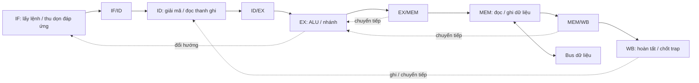

# Đặc tả core RV32I, bus và ngoại vi

Phiên bản 3.0 — 26/09/2026. Bảng tín hiệu, điều kiện lấy mẫu và yêu cầu bắt buộc
được quy định tại [đặc tả giao tiếp RTL](giao_tiep_rtl_vi.md).

## 1. Phạm vi baseline

Baseline này gồm core RV32I pipeline 5 tầng, bus Harvard 32 bit, ROM/SRAM,
GPIO, UART **TX/RX 8N1**, I²C master một chủ và timer 64 bit. Clock duy nhất;
reset tích cực cao, trạng thái reset tại cạnh lên. Board đưa các đầu vào bất
đồng bộ qua synchronizer trước khi nối vào SoC.

Model, thuật toán firmware và datapath accelerator không được phát triển trong
đợt này. Vùng `0x2000_3000` vẫn dành cho khối mở rộng hiện có để giữ tương thích.
DMA, arbitration nhiều master, interrupt/CSR và các extension
M/A/C/Zicsr/Zifencei không thuộc baseline. Không tuyên bố đã chạy bộ chứng nhận ISA.

Các lệnh và chính sách trap được liệt kê trong [isa_scope_vi.md](isa_scope_vi.md).
Quy tắc ISA đối chiếu [RISC-V RV32I v2.1](https://docs.riscv.org/reference/isa/v20240411/unpriv/rv32.html).
Giao dịch I²C đối chiếu mục 3.1 của [NXP UM10204](https://www.nxp.com/docs/en/user-guide/UM10204.pdf).

## 2. Cấu trúc mã nguồn theo pipeline

```text
rtl/core/
├── rv32_core.v                 kết nối tầng, thanh ghi giữa tầng và điều khiển
├── rv32_defs.vh                mã điều khiển, forwarding và cause dùng chung
├── if/
│   ├── rv32_if_stage.v         PC, dừng/đổi hướng, yêu cầu chờ grant, điều phối IF
│   ├── rv32_if_request_queue.v PC/cờ hủy của yêu cầu đã grant, chờ đáp ứng
│   └── rv32_if_fifo.v          FIFO IF/ID hai phần tử lệnh/ngoại lệ
├── id/
│   ├── rv32_id_stage.v         decode + immediate + đọc register file
│   ├── rv32_decoder.v
│   ├── rv32_imm_gen.v
│   └── rv32_regfile.v
├── ex/
│   ├── rv32_ex_stage.v         forwarding, ALU, nhánh, kiểm alignment
│   ├── rv32_alu.v
│   └── rv32_branch_unit.v
├── mem/rv32_mem_stage.v        load/store, handshake, chọn dữ liệu về WB
├── wb/rv32_wb_stage.v          commit thanh ghi, trace, trap/halt
├── pipeline/
│   ├── rv32_id_ex_reg.v        chốt ID/EX; lưu lại toán hạng khi MEM chờ
│   ├── rv32_ex_mem_reg.v       chốt EX/MEM; giữ khi MEM chờ, xóa khi MEM lỗi
│   └── rv32_mem_wb_reg.v       chốt MEM/WB; xóa valid khi MEM chờ
├── control/
│   ├── rv32_hazard_unit.v      phụ thuộc thanh ghi, lựa chọn forwarding
│   └── rv32_pipeline_control.v ưu tiên event, stall và flush
└── common/rv32_lsu.v           alignment/lane dùng chung ở EX và MEM

rtl/bus/soc_bus.v               decode địa chỉ, chọn slave và response
rtl/memory/                    ROM/RAM handshake và backend M9K
rtl/peripherals/               GPIO, UART TX, uart/ TX-RX wrapper, I²C, timer
rtl/soc/rv32_soc.v              kết nối hệ thống
rtl/board/de10_lite_top.v       synchronizer, open-drain và chân board
```

Unit test core nằm trong `tb/core/if`, `id`, `ex`, `control`, `common`; test chương
trình và trap nằm trực tiếp trong `tb/core`. Test bus, memory, peripheral và SoC
được đặt trong thư mục tương ứng dưới `tb/`.



Module tầng chứa chức năng thật, không thêm clock stage chỉ để chia file.
Top `rv32_core` chỉ kết nối; ba module trong `pipeline` giữ thanh ghi giữa
tầng và các quy tắc cập nhật riêng. `rv32_if_stage` giữ PC, trạng thái dừng
và yêu cầu chờ grant; hàng đợi yêu cầu đã grant và FIFO IF/ID nằm trong hai
module con. Khi hủy đồng thời thêm/lấy yêu cầu, số lượng và PC vẫn cập nhật;
các phần tử còn lại và yêu cầu mới đều mang cờ hủy. Flush FIFO ưu tiên hơn
thêm/lấy, chỉ xóa số phần tử, giữ dữ liệu cũ không còn hợp lệ.
`ifid_*`, `idex_*`, `exmem_*`, `memwb_*` là payload của các ranh giới pipeline.
Hậu tố `_q` biểu thị giá trị đã chốt, tại top là dây nối từ module con;
`_i`/`_o` là cổng. Payload chỉ có nghĩa
khi `valid=1`; flush/bubble chỉ cần xóa valid, không phải xóa toàn bộ dữ liệu.

| Tầng | Trạng thái / trách nhiệm | Hành vi khi bị chặn |
|---|---|---|
| IF | Giữ PC, metadata yêu cầu và FIFO 2 phần tử; đầu FIFO là IF/ID | Giữ request tới grant; đặt trước chỗ cho đáp ứng; nhận/bỏ đáp ứng sai đường |
| ID | Decoder, immediate, 2 cổng đọc RF; RF chỉ ghi theo WB | ID/EX được giữ hoặc chèn bubble theo control |
| EX | Chọn toán hạng sau chuyển tiếp, ALU, đích nhánh, kiểm căn chỉnh | Khi MEM chờ, `rv32_id_ex_reg` lưu lại toán hạng đã chuyển tiếp để không mất giá trị WB |
| MEM | LSU, một data transaction, lỗi truy cập | Giữ EX/MEM và payload bus tới response |
| WB | Ghi RF, xuất trace; chốt trap và halt | WB cũ commit một lần rồi MEM/WB bị clear khi MEM stall |

Forwarding ưu tiên EX/MEM hơn MEM/WB; load chưa có dữ liệu không forward từ
EX/MEM. Load-use chèn bubble; x0 và operand không được lệnh dùng không tạo hazard.
JAL/JALR ghi PC+4, đích JALR xóa bit 0 rồi kiểm alignment 4 byte. Nhánh không
taken không gây trap vì đích lệch hàng.

Ưu tiên event: **reset → trap tại WB → lỗi tại MEM → lỗi/redirect tại EX →
ngoại lệ ID → fetch**. Trong lúc MEM chờ, event trẻ hơn chưa được thực thi.
Redirect của lệnh cũ được phép hủy lỗi fetch/decode sai đường.

WB là điểm commit **thanh ghi và retirement**. Store được slave thực hiện trong
giao dịch MEM; core không phát store khi có exception cũ hơn đang tới WB.
Lệnh fault không retire, không ghi rd. Load tới x0 vẫn thực hiện truy cập và có
thể fault. `trap_valid`/`halted` giữ tới reset; không có trap handler hay return.
Sau halt, fetch chưa grant vẫn được giữ tới grant; các yêu cầu đã grant vẫn
nhận rồi bỏ đáp ứng `rvalid`; không phát fetch mới. Trace `retire_*` hợp lệ
trong chu kỳ `retire_valid=1` ngay sau cạnh
commit; các chu kỳ retire liên tiếp không bắt buộc có chu kỳ thấp xen giữa.

## 3. Contract bus

Bus word 32 bit little-endian, địa chỉ byte, một master; instruction và data
độc lập. Không phải AXI/APB/Wishbone. Hai cổng dùng **hai giao thức khác nhau**.

Cổng instruction nhận địa chỉ tại `req && gnt`, trả đáp ứng tại `rvalid` độc
lập, theo thứ tự grant và sớm nhất một cạnh sau grant. Không có `rready`; tổng
số phần tử FIFO, yêu cầu chờ đáp ứng và yêu cầu chờ grant không vượt hai.
Địa chỉ chỉ phải giữ tới grant. Redirect không hủy giao dịch bus, chỉ đánh dấu
bỏ đáp ứng cũ. Core và memory phải reset đồng thời. Xem yêu cầu IF-01..IF-10
trong [đặc tả giao tiếp RTL](giao_tiep_rtl_vi.md).

Cổng data dùng giao thức một giao dịch `req/ready`:

1. Master đặt `req=1` cùng `addr`, `we`, `wdata`, `wstrb` hợp lệ.
2. Giữ request và payload không đổi suốt mọi cạnh chưa có `ready`.
3. Response được lấy mẫu tại cạnh lên có `req && ready`.
4. Khi đó `err=0` là thành công, `err=1` là fault. `err` riêng lẻ khi chưa
   ready không phải response; fabric chỉ đưa err lên master khi ready.
5. Sau cạnh hoàn tất, master có thể đưa request kế tiếp, kể cả không hạ req.
   Reset hệ thống là trường hợp duy nhất cho phép hủy request đang chờ.

`addr[1:0]` trên bus luôn bằng 0. LSU chuyển địa chỉ byte/halfword của ISA về
word-aligned và dịch `wdata/wstrb`. `wstrb[n]` điều khiển byte `[8n+7:8n]`.
Các lane không bật phải được bảo toàn. Write strobe 0 vào thanh ghi RW là no-op;
truy cập địa chỉ sai hoặc ghi RO vẫn fault dù strobe bằng 0.

Fabric có thanh ghi request và response, một giao dịch outstanding. Thứ tự lane:
`0 ROM, 1 SRAM, 2 GPIO, 3 UART, 4 I²C, 5 QNN, 6 timer`.
Chỉ một `slave_req` được bật. Trong reset/idle/response không chọn slave.
Tại cạnh N chụp request; slave zero-wait hoàn tất sớm nhất N+1; CPU nhận
response ở N+2. Slave chờ thêm W clock thì CPU hoàn tất ở N+W+2.
Request kế tiếp có thể giữ req liên tục nhưng payload mới chỉ chụp ở N+W+3.
Không chụp lại request cũ ở cạnh trả response. Ready/error/data CPU chỉ lấy từ
response đã chốt, không phụ thuộc trực tiếp slave hiện tại.

Địa chỉ sai, lệch word hoặc ghi ROM trả lỗi đã đăng ký, không chọn slave.
MMIO giải mã `addr[31:12]`; từng peripheral nhận **đủ offset 12 bit** và báo lỗi
cho register chưa định nghĩa. Không mirror thanh ghi ở offset cao.

| Khoảng địa chỉ mặc định | Đích | Quyền |
|---|---|---|
| `0000_0000..0000_7FFF` | ROM 8192 word | Fetch/read |
| `1000_0000..1000_1FFF` | SRAM 2048 word | Read/write |
| `2000_0000..2000_0FFF` | GPIO | Theo thanh ghi |
| `2000_1000..2000_1FFF` | UART TX/RX | Theo thanh ghi |
| `2000_2000..2000_2FFF` | I²C | Theo thanh ghi |
| `2000_3000..2000_3FFF` | QNN | Theo thanh ghi |
| `2000_4000..2000_4FFF` | Timer | Theo thanh ghi |

ROM_WORDS/RAM_WORDS phải dương, vùng nhớ không chồng lấn MMIO. Reset hủy
transaction pending nhưng không rollback side effect đã xảy ra ở slave trước
khi CPU nhận response. Instruction vẫn nối trực tiếp ROM, không qua data bus.


## 4. ROM và SRAM

`soc_rom_dp` có hai cổng đọc độc lập. `soc_ram` một cổng, có 4 byte-enable.
Địa chỉ module memory là offset tính từ đầu vùng. Range và alignment được
kiểm tra trước khi enable storage, kể cả với WORDS không phải lũy thừa của 2.

Cổng instruction ROM nhận tại cạnh N, core lấy đáp ứng tại N+1. Có thể nhận
một địa chỉ và trả một word mỗi chu kỳ, không có chu kỳ trống bắt buộc.

Ở giao tiếp slave, cổng data ROM và SRAM chụp yêu cầu ở N, đăng ký ready/data sau N+1 để master
hoàn tất ở N+2. Wrapper không chụp lại request cũ ở cạnh hoàn tất. Yêu cầu kế
tiếp được chụp sớm nhất ở N+3; các cổng này không đạt một word mỗi chu kỳ. Tính từ cạnh bus chụp request CPU,
ROM/RAM hoàn tất CPU sau 4 clock: bus thêm một cạnh chụp và một cạnh trả response.

Reset xóa pending/response, không xóa nội dung storage. SRAM không có giá trị
khởi tạo bảo đảm. Write có thể cập nhật storage ngay ở cạnh capture, trước
response; reset không rollback write đã capture. Reset không được tạo write
mới dù req/we đang cao. Read trả dữ liệu cũ trong giao dịch ghi; master bỏ qua
rdata khi write. Lỗi trả rdata=0 và không enable storage.

## 5. GPIO (`0x2000_0000`)

| Offset | Thanh ghi | Quyền / reset | Ý nghĩa |
|---|---|---|---|
| `0x000` | LED | RW / 0 | `GPIO_LED_WIDTH` bit thấp, mặc định 8 |
| `0x004` | SWITCH | RO | 10 switch đã đồng bộ |

Slave zero wait. Mỗi lane chỉ cập nhật bit tồn tại; phần vượt độ rộng đọc 0,
ghi bỏ qua như reserved bits. Tham số hỗ trợ 1..32 bit, test cấu hình 8 và 10.
Board cố định `LEDR[7:0]=GPIO`, `LEDR[8]=QNN_BUSY`, `LEDR[9]=CPU_TRAP`.
Header firmware khai báo `GPIO_LED_WIDTH=8`, không coi hai LED debug là GPIO.

## 6. UART TX/RX (`0x2000_1000`)

| Offset | Thanh ghi | Quyền / reset | Ý nghĩa |
|---|---|---|---|
| `0x000` | TX_DATA | RW / đọc 0 | Ghi lane0 nhận một byte vào TX/FIFO |
| `0x004` | STATUS | RO / `0x09` | Bảng bit bên dưới |
| `0x008` | RX_DATA | RO/pop | Đọc một byte `[7:0]`; rỗng trả access fault |
| `0x00C` | ERRORS | RW/W1C / 0 | Đọc lỗi ở `[7:5]`; ghi 1 lane0 xóa bit tương ứng |

| Bit STATUS | Tên | Ý nghĩa |
|---|---|---|
| 0 | TX_READY | Có chỗ nhận byte TX |
| 1 | TX_BUSY | FIFO TX hoặc serializer còn dữ liệu chưa phát hết |
| 2 | RX_VALID | FIFO RX có byte |
| 3 | RX_EMPTY | FIFO RX rỗng |
| 4 | RX_FULL | FIFO RX đầy |
| 5 | RX_OVERRUN | Byte mới bị drop khi FIFO đầy, sticky |
| 6 | RX_FRAMING_ERROR | Stop bit thấp, frame bị loại, sticky |
| 7 | RX_FALSE_START | Start không còn thấp tại giữa bit, sticky |

TX giữ 8N1, FIFO mặc định 4 byte ngoài serializer. `TX_FIFO_DEPTH=0` phục hồi
chế độ không FIFO; module `soc_uart_tx` và test cũ vẫn giữ. TX_DATA lane0 chờ
khi hết chỗ; no-op strobe không chờ. Chờ TX_BUSY=0 để flush, TX_READY không
đồng nghĩa dây đã idle. Reset bỏ FIFO và frame, đưa TX về mức cao.

RX có module `uart_rx`, `uart_rx_fifo`, wrapper `soc_uart`. Đồng bộ hai FF
ngay trong RX; lấy mẫu giữa start, giữa từng bit và giữa stop bằng clock hệ
thống, không dùng bộ chia 16x. Bộ chia là `round(CLOCK_HZ/BAUD)`, cần ít nhất
8 clock/bit. Đã kiểm tra divisor 8/9/100; sai lệch ±3% kiểm tại divisor 100.
Không có majority voting hoặc bảo đảm chống mọi loại glitch.

FIFO RX mặc định 16 byte; hỗ trợ độ sâu không phải lũy thừa 2. Đọc RX_DATA chỉ
pop tại `req && ready && !err`, mỗi transaction đúng một byte. Đầy và pop/push
cùng cạnh không mất byte; nếu không pop thì bỏ byte mới và đặt overrun.
Event lỗi mới thắng clear cùng cạnh. Chỉ ghi lane0 mới xóa ERRORS. STATUS và
RX_DATA là RO, ghi cả zero-strobe vẫn fault. Mọi offset khác, kể cả trong
page 4 KiB, fault. Phần mềm poll RX_VALID trước đọc RX_DATA. Chưa có IRQ UART.

Board: TX=`PIN_V9` (JP1 GPIO[2]), RX=`PIN_W9` (JP1 GPIO[3]), RX có pull-up khi
không nối dây. SDC chỉ bỏ timing từ RX pad tới FF đồng bộ đầu tiên.


## 7. I²C (`0x2000_2000`)

| Offset | Thanh ghi | Quyền / reset | Ý nghĩa |
|---|---|---|---|
| `0x0` | DATA | RW / 0 | Ghi byte TX lane0; đọc buffer RX ở `[7:0]` |
| `0x4` | CMD | WO, đọc 0 | bit0 START, bit1 STOP, bit2 READ, bit3 NACK, bit4 CLEAR_DONE, bit5 RECOVER, bit6 CLEAR_ERRORS, bit7 EXECUTE |
| `0x8` | STATUS | RO / 0 | bit0 busy, bit1 done, bit2 ack_error, bit3 timeout, bit4 recovery_error |
| `0xC` | DIVIDER | RO | `floor(CLOCK_HZ/(2*I2C_HZ))`, mặc định 250 |

Ghi CMD/DATA có lane0 khi busy phải chờ, ngoại trừ RECOVER được nhận ngay để
hủy lệnh cũ. Các byte-enable khác không tác động, kể cả lên các bit clear/recover.
CLEAR_DONE, CLEAR_ERRORS và RECOVER độc lập EXECUTE; RECOVER ưu tiên EXECUTE. Mỗi
EXECUTE chốt cờ lệnh, xóa done/ack_error/buffer RX và chạy đúng một byte.
READ=0 phát DATA rồi đọc ACK; READ=1 nhận 8 bit rồi phát ACK (`NACK=0`) hoặc
NACK (`NACK=1`). ack_error phản ánh NACK của target trong write; read không
coi NACK do chính controller phát là lỗi. done sticky tới CLEAR_DONE/EXECUTE/RECOVER/reset.
timeout/recovery_error sticky tới CLEAR_ERRORS/reset; EXECUTE mới không tự xóa
hai cờ này. CLEAR_ERRORS xóa cả ack_error. Lỗi timeout/recovery cũng đặt
ack_error để firmware cũ kiểm tra bit2 nhận ra thất bại.

Không STOP thì kết thúc byte bằng **giữ SCL thấp, nhả SDA**, kể cả trong khoảng
chờ phần mềm; lệnh tiếp theo tiếp tục byte hoặc phát repeated START. Có STOP
thì nhả SCL, chờ cao, nhả SDA và chờ pha STOP hoàn tất trước khi clear busy.

Clock stretching áp dụng cả START, bit data, ACK và STOP. Bộ đếm pha cao được
khởi động lại trong lúc chân SCL còn thấp, nên sau khi target nhả vẫn có đủ
thời gian pha cao. START cũng chờ SDA được nhả. Không multi-master/arbitration
hoặc bộ lọc glitch. Các đầu vào module phải đã đồng bộ; top DE10-Lite có hai FF.
Output chỉ là lệnh kéo thấp open-drain, không
lái mức cao. CLOCK_HZ/I2C_HZ phải dương, HALF_DIV ít nhất 2; timing điện và
pull-up thực tế vẫn cần kiểm tra trên board.

`TIMEOUT_CYCLES` giới hạn mỗi lần chờ chân SCL/SDA liên tục, không giới hạn
tổng thời gian byte. Mặc định `max(CLOCK_HZ/100, 1024)` (10 ms tại 50 MHz);
0 vô hiệu watchdog. Không đếm pha thấp do master phát hay khoảng phần mềm
giữ SCL giữa hai byte. Khi hết hạn: hủy FSM, nhả cả hai chân, clear busy,
set done/timeout/ack_error. Nếu có ghi DATA/CMD đang chờ, trả `ready+err` ở
chu kỳ kế tiếp, không thực hiện ghi đó. Bus đưa fault về core như lỗi store
thông thường; firmware nên poll busy để đọc và xử lý lỗi qua STATUS.

RECOVER nhả SDA, phát tối đa 9 xung SCL phục hồi; khi SDA cao, tạo STOP và
chờ hai chân đã được đồng bộ lên cao. Việc tạo STOP có thêm cạnh lên SCL,
không tính trong 9 xung phục hồi. SCL bị giữ thấp vẫn chịu watchdog;
hết 9 xung mà SDA chưa nhả đặt recovery_error, nhả output và kết thúc.
Không có mux tranh quyền giữa hai FSM. Phục hồi do phần mềm yêu cầu, không
tự lặp vô hạn. SCL bị giữ thấp lâu có thể cần reset/power-cycle thiết bị ngoài
theo [NXP UM10204 §3.1.16](https://www.nxp.com/docs/en/user-guide/UM10204.pdf).

`firmware/main.c` kiểm tra toàn bộ cờ lỗi, thử phục hồi một lần rồi bỏ mẫu đo
lỗi. Header C có tên cho các bit mới. Ảnh ROM demo không tự được thay bằng
firmware ứng dụng; dùng script build firmware khi muốn triển khai ứng dụng.

Ví dụ đọc hai byte sau ghi register pointer: write address với START → write
pointer → write read-address với repeated START → READ+ACK → READ+NACK+STOP.

## 7.1. QNN MMIO (`0x2000_3000`)

`CONTROL=0x000`, `STATUS=0x004`, `RESULT=0x008`, `CYCLES=0x00C`,
`CONFIG=0x010`; 80 feature ở `0x100..0x23C`, mỗi feature dùng lane0 của word.
Ghi feature lane0 hoặc CONTROL.START khi busy giữ ready=0 đến QNN rảnh.
Write chỉ xảy ra tại handshake thành công; không báo success rồi bỏ dữ liệu.
No-op strobe, read và CLEAR_DONE không kèm START không chờ. Offset sai/lệch
word hoặc ghi RO trả fault. Reset chặn handshake. Datapath/model giữ nguyên.

## 8. Timer (`0x2000_4000`)

| Offset | Thanh ghi | Quyền / reset | Ý nghĩa |
|---|---|---|---|
| `0x0` | TIME_LO | RO / 0 | 32 bit thấp; đọc chốt TIME_HI cùng thời điểm |
| `0x4` | TIME_HI | RO / 0 | Snapshot từ lần đọc LO gần nhất; trước lần đó trả HI trực tiếp |
| `0x8` | CMP_LO | RW / FFFFFFFF | 32 bit compare thấp, 4 byte-enable |
| `0xC` | CMP_HI | RW / FFFFFFFF | 32 bit compare cao, 4 byte-enable |

Counter tăng mỗi cạnh clock sau reset, modulo 2^64. Đọc LO rồi HI cho một
timestamp nhất quán dù LO rollover giữa hai lần đọc. Snapshot được giữ tới
lần đọc LO tiếp theo hoặc reset. Compare không có shadow/commit: ghi từng
nửa 32 bit cập nhật ngay và có thể làm IRQ thay đổi giữa hai lần ghi.
`irq = time >= compare`, ngoại trừ compare=all-ones vô hiệu IRQ kể cả tại cực
đại counter. IRQ là mức, không sticky. Hiện SoC không nối IRQ này vào core.

## 8.1. Reset board

`reset_controller` dùng power-up value của FF MAX10/Quartus để giữ POR
`POR_CYCLES=1024` clock sau configuration, rồi thêm 3 clock đồng bộ nhả reset.
KEY[0] assert bất đồng bộ, nhả qua cùng chuỗi 3 FF. Không cần nhấn KEY lúc bật
board. Các state timer/QNN/UART/core được reset bằng tín hiệu chung.
POR không phải mạch phát hiện brown-out hoặc mất clock; phụ thuộc clock board.

## 9. Kiểm thử và tiêu chí hoàn tất

```bash
python3 scripts/run_tests.py --scope base  # core/bus/memory/peripheral/SoC MMIO
python3 scripts/run_tests.py --scope all   # thêm các regression QNN có sẵn
```

PowerShell/ModelSim dùng `./scripts/run_tests.ps1 -Scope Base` hoặc `-Scope All`.
Script tìm source/testbench đệ quy nên tuân theo cấu trúc thư mục mới.
Testbench SoC MMIO tự nạp instruction vào ROM mô phỏng; không build firmware
hoặc cài model. Kết quả kiểm thử và Quartus xem
[báo cáo freeze, ISA và firmware](bao_cao_freeze_isa_soc_vi.md).

Tiêu chí: mỗi test kết thúc với PASS, không có fatal/timeout; testbench phải kiểm
response lỗi, byte-enable, reset và timing; request stalled phải ổn định; trap
phải chính xác theo tuổi lệnh; FPGA phải tổng hợp/fit thành công và đáp ứng
clock 50 MHz. Mô phỏng số không thay cho kiểm tra tín hiệu điện trên board.
