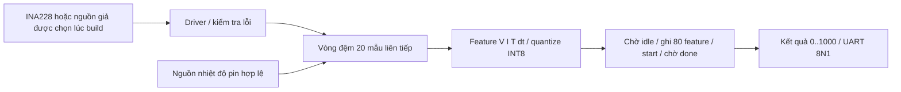

# Firmware 20 mẫu và INA228

## Phần cứng được chọn

Theo cập nhật của người dùng, cảm biến là **INA228**, thay cho INA219 trong yêu cầu
ban đầu. Driver mới dùng register map INA228, không dùng công thức INA219.

Driver đọc ID 0x3E/0x3F; cấu hình range và calibration; dùng triggered conversion
cho VBUS/VSHUNT/DIETEMP rồi poll trạng thái hữu hạn. VBUS/CURRENT/VSHUNT đọc 3 byte
MSB-first, bỏ 4 bit thấp; CURRENT/VSHUNT mở rộng dấu 20 bit. DIETEMP là số có dấu
16 bit. Calibration dùng CURRENT_LSB và điện trở shunt thực, có hệ số range.
Các giá trị quy đổi đều bằng số nguyên. Tham chiếu: [TI INA228 SLYS021A, §7.6 và
§8.1.2](https://www.ti.com/lit/ds/symlink/ina228.pdf).

DIETEMP đo **nhiệt độ die của chip**. Đây chưa phải nhiệt độ pin trong dữ liệu huấn
luyện CALCE; firmware giữ hai khái niệm riêng. Chưa xác nhận cảm biến nhiệt độ pin
hoặc tái huấn luyện mô hình phù hợp thì firmware báo `CELL_TEMP_REQUIRED`, không
gán nhiệt độ cố định. [TI INA228, §7.6.1.7](https://www.ti.com/lit/ds/symlink/ina228.pdf).

## Cấu trúc và contract phần mềm



- `sample_pipeline.c`: giữ mẫu raw và bit validity; vòng đệm 20 phần tử,
  xuất oldest-first. Chưa đủ 20 mẫu thì không chạy QNN. Mất mẫu hoặc dt ngoài
  (0,15000] ms thì xóa lịch sử để tránh ghép hai đoạn rời nhau.
- `ina228.c`: transport được truyền qua function pointer, cho phép test C độc lập.
  ID sai, calibration sai/reset sensor, lỗi I/O, conversion timeout, MATHOF,
  MEMSTAT hoặc điện áp ngoài dải đều trả lỗi; output không đổi khi thất bại.
- `soc_platform.c`: UART dùng STATUS bit mask; timeout timer kèm giới hạn số poll.
  I²C có một lần recovery; không lặp vô hạn. Trước DATA write phải chờ idle.
  QNN chờ idle, xóa done cũ, ghi đủ feature rồi start và chờ busy=0/done=1.
- `main.c`: hai nguồn mô phỏng được chọn rõ lúc build; board không tự chuyển sang
  dữ liệu giả khi sensor lỗi. Lỗi sensor xóa cửa sổ và thử khởi tạo lại ở vòng sau.
  Polling timer thay interrupt. Khoảng đo thực được ghi vào dt của mẫu board.
- `runtime.c`: memcpy nhỏ cho phép gán struct trong môi trường freestanding.
  Multiply/divide cần thiết do `libgcc` RV32I thực hiện bằng phần mềm.

## Cấu hình board còn cần xác nhận

`firmware/include/board_config.h` để địa chỉ, shunt và CURRENT_LSB bằng 0 để biểu
thị **chưa cấu hình**. Firmware board in `CONFIG_REQUIRED` rồi kết thúc bằng
EBREAK nếu chưa có thông số. Đây không phải phát hiện chip tự động.

Cần điền địa chỉ I²C 7 bit, điện trở shunt (micro-ohm), CURRENT_LSB (nanoamp/count),
range và đối chiếu chiều dòng. Model hiện dùng **dòng dương khi sạc**; cách nối
IN+/IN− trên board phải khớp quy ước. Nhiệt độ pin cần một nguồn thật hoặc mô hình
đã được huấn luyện lại; việc thay bằng die temperature phải được đánh giá riêng.

Test dùng địa chỉ 0x40, shunt 10 mΩ, CURRENT_LSB 10 µA/count, range 0 **chỉ trong
mô phỏng**, không coi đây là thông số phần cứng của người dùng.

## Build và test

Trong Ubuntu/WSL tại repo:

```bash
python3 scripts/check_core_freeze.py
python3 scripts/run_isa.py
python3 scripts/run_firmware_tests.py
python3 scripts/build_firmware.py --prefix riscv64-unknown-elf- --output-dir firmware/build/board_review
```

`run_firmware_tests.py` rebuild cả firmware giả, INA228 giả lập ở chân I²C và board;
sinh ảnh test cùng manifest SHA256 vào `tb/soc/firmware_assets`; chạy hai nhóm test
C và 9 kịch bản RTL. Ảnh boot mặc định tại `firmware/build/boot.*` được giữ nguyên.
Firmware mới chưa cài vào ROM Quartus và chưa nạp board. Không nhầm `.sof` baseline
đang có với ảnh firmware mới đã chạy trong simulation.

Các fixture golden dùng Python độc lập: 25 mẫu tạo 6 cửa sổ, 480 feature được
đối chiếu tại handshake QNN, 6 kết quả so với model nguyên đã cài, 63 byte được
giải mã từ chân UART. Hai nguồn đều dùng **nhiệt độ pin giả được khai báo rõ**;
nguồn INA228 còn đo die temperature riêng để kiểm tra driver.

Các fault ở mức chân: NACK địa chỉ, SCL kẹt, ID sai, không hoàn tất conversion,
MATHOF, NACK register pointer giữa acquisition, mất calibration. Không ca lỗi nào
được phép ghi feature/start QNN hoặc xuất dòng `SOC=`.

## Thử board sau simulation

Quy trình đo, bảng chân từ QSF và biểu mẫu bằng chứng nằm trong
[kiểm chứng board](kiem_chung_board_vi.md). Các phép đo vẫn chưa thực hiện.

Kiểm tra lại ngày 2026-09-28: `quartus_pgm -l` trả `No JTAG hardware available`.
Chưa nạp FPGA hoặc xác nhận chân/cảm biến thật. Sau khi có kết nối và cấu hình:

1. LED/GPIO sanity.
2. UART TX, rồi UART RX.
3. Timer polling.
4. Probe I²C và kiểm tra manufacturer/device ID của INA228.
5. Đối chiếu điện áp/dòng với dụng cụ đo, xác nhận shunt và chiều dòng.
6. QNN standalone với vector golden.
7. CPU + QNN + UART.
8. Luồng đầy đủ sau khi giải quyết nguồn nhiệt độ pin.

Thông qua mô phỏng xác minh giao thức và số học; chưa xác nhận độ chính xác SOC
trên pin thực, chất lượng sensor, nguồn nhiệt độ hoặc khả năng tổng quát hóa model.
