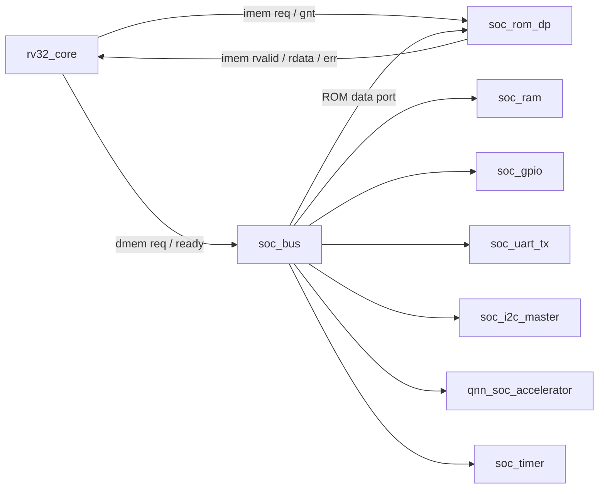

# Đặc tả giao tiếp RTL của core RV32I và SoC

Phiên bản tích hợp: 3.0, ngày 27/09/2026; handshake core vẫn tương thích 2.0.
Tài liệu này quy định giao tiếp đang
được triển khai trong RTL. Các từ **phải**, **không được** và **được phép** là
yêu cầu bắt buộc, điều cấm và quyền lựa chọn của bên tích hợp. Đây là giao thức
nội bộ của dự án; không tuyên bố tương thích AXI, APB, Wishbone hoặc chứng nhận
theo một tiêu chuẩn công nghiệp bên ngoài.

## 1. Quy ước chung

| Thuộc tính | Quy định |
|---|---|
| Hướng cổng | `_i` là đầu vào, `_o` là đầu ra theo module khai báo cổng |
| Trạng thái | `_q` biểu thị giá trị đã chốt; ở module cha có thể là dây nối từ module con. Payload chỉ có nghĩa khi tín hiệu hợp lệ tương ứng bằng 1 |
| Clock | Các giao tiếp logic trong SoC cùng miền `clk_i`, lấy mẫu tại cạnh lên |
| Reset | `rst_i` tích cực cao; phải giữ qua ít nhất một cạnh lên; xóa trạng thái giao dịch đồng bộ |
| Dữ liệu | 32 bit, little-endian; địa chỉ là địa chỉ byte, unsigned |
| Giá trị điều khiển | Không được có X/Z tại cạnh lấy mẫu; không dùng `casex` để che trạng thái không xác định |
| Payload không hợp lệ | Bên nhận phải bỏ qua; không giả định payload bằng 0 trừ khi được quy định riêng |
| Tín hiệu bất đồng bộ | Chỉ đưa vào logic SoC sau đồng bộ hóa tại lớp board |

Ký hiệu N là một cạnh lên. “Nhận ở N, trả ở N+1” nghĩa là memory nhận yêu cầu
tại N, làm ổn định đáp ứng trong khoảng N đến N+1, core lấy mẫu đáp ứng tại N+1.
Không được đồng nhất thời điểm tín hiệu đổi sau cạnh với cạnh bên nhận lấy mẫu.

## 2. Giao tiếp lấy lệnh của `rv32_core`

### 2.1. Danh sách tín hiệu

| Cổng | Hướng tại core | Bit | Ý nghĩa |
|---|---|---:|---|
| `imem_req_o` | Ra | 1 | Yêu cầu đọc lệnh, payload địa chỉ hợp lệ |
| `imem_addr_o` | Ra | 32 | Địa chỉ byte; `addr[1:0]=0` khi `req=1` |
| `imem_gnt_i` | Vào | 1 | Memory chấp nhận yêu cầu tại cạnh có `req && gnt` |
| `imem_rvalid_i` | Vào | 1 | Một đáp ứng cho yêu cầu đã được nhận trước đó |
| `imem_rdata_i` | Vào | 32 | Word lệnh, hợp lệ khi `rvalid && !err` |
| `imem_err_i` | Vào | 1 | Lỗi truy cập lấy lệnh, chỉ có nghĩa khi `rvalid=1` |

### 2.2. Quy tắc giao dịch

| Mã | Yêu cầu |
|---|---|
| IF-01 | Yêu cầu được nhận đúng một lần tại mỗi cạnh có `req && gnt`. `gnt` khi `req=0` không tạo giao dịch. |
| IF-02 | Sau cạnh có `req && !gnt`, core phải giữ `req=1` và địa chỉ không đổi tới cạnh grant; chỉ reset được phép hủy. |
| IF-03 | Sau grant, core được phép đổi địa chỉ ngay trong chu kỳ kế tiếp, kể cả giữ `req=1` liên tục. |
| IF-04 | Mỗi yêu cầu được nhận phải có đúng một đáp ứng; thứ tự đáp ứng phải trùng thứ tự grant. Không có transaction ID. |
| IF-05 | Đáp ứng sớm nhất ở cạnh kế tiếp sau grant. Không hỗ trợ đáp ứng zero-cycle cho yêu cầu mới tại cùng cạnh grant. |
| IF-06 | Không có `rready`. Core phải nhận mọi đáp ứng hợp lệ; memory được phép trả đáp ứng liên tiếp ở mỗi cạnh. |
| IF-07 | `rvalid` độc lập với `req`; đáp ứng vẫn được trả khi core không phát yêu cầu mới. `err` không đi kèm `rvalid` phải bị bỏ qua. |
| IF-08 | Grant và đáp ứng cho một yêu cầu cũ được phép xảy ra ở cùng cạnh. |
| IF-09 | Có tối đa hai yêu cầu đã grant chưa có đáp ứng. Tổng FIFO + yêu cầu đã grant chưa trả + yêu cầu đang chờ grant không vượt hai. |
| IF-10 | Memory phải hoàn tất yêu cầu đã nhận, kể cả sau redirect hoặc halt. Thiết kế không có timeout hoặc cơ chế retry tự động. |

`rv32_if_stage` đặt trước chỗ cho mỗi đáp ứng bằng bộ đếm credit. Khi ID dừng,
FIFO giữ nguyên phần tử đầu nhưng vẫn nhận các đáp ứng đã được đặt chỗ. Một
phần tử được ID lấy ở cùng cạnh cho phép cấp chỗ cho yêu cầu tiếp theo.

PC, trạng thái dừng và yêu cầu chờ grant được giữ trong `rv32_if_stage`.
`rv32_if_request_queue` giữ PC/cờ hủy của yêu cầu đã grant;
`rv32_if_fifo` giữ lệnh/ngoại lệ chờ ID. Hai bộ đệm này cùng dùng ngân sách
hai chỗ ở IF-09; việc tách module không tạo thêm chỗ hay thêm chu kỳ.

### 2.3. Redirect và ngoại lệ

Redirect xóa các lệnh đang chờ trong FIFO, đặt PC đích và đánh dấu hủy từng yêu
cầu cũ. Yêu cầu đang chờ grant vẫn giữ địa chỉ cũ; khi được grant, nó mang cờ hủy
vào hàng đợi. Mọi đáp ứng cũ, kể cả đáp ứng báo lỗi, được nhận để giải phóng giao
dịch nhưng không được đưa vào ID. Cờ hủy không tự đảo khi có thêm redirect.

Trong hàng đợi yêu cầu, đánh dấu hủy **phải thắng** các phép ghi cờ hủy khi
thêm/lấy ở cùng cạnh, kể cả đối với yêu cầu vừa được nhận. Số phần tử và PC
vẫn cập nhật theo thêm/lấy; đánh dấu hủy không xóa giao dịch đang chờ.
Flush FIFO xóa số phần tử; bên nhận không được sử dụng dữ liệu cũ khi
FIFO rỗng. Yêu cầu chờ grant và yêu cầu chờ đáp ứng vẫn được giữ để hoàn tất
bắt tay và thu dọn đáp ứng.

Lỗi lấy lệnh hợp lệ tạo một phần tử `{PC, instr=0, exc_valid=1, cause=1}` và
dừng phát yêu cầu mới. Các yêu cầu trẻ hơn bị đánh dấu hủy. Lỗi này vẫn có thể
bị nhánh già hơn loại bỏ. Vector reset lệch hàng tạo cause 0 tại IF mà không
phát truy cập bộ nhớ; đích branch/JAL/JALR lệch hàng được phát hiện tại EX.

### 2.4. Reset toàn hệ thống

Core và memory **phải được reset đồng thời**, hoặc bộ chuyển tiếp phải bảo đảm
mọi đáp ứng trước reset đã bị hủy trước khi cho phép giao dịch mới. Reset xóa
metadata, FIFO và trạng thái pending của ROM; `imem_req_o=0` trong reset.

Bus không có ID hoặc số thế hệ trên dây, nên không thể phân biệt một đáp ứng
cũ đến muộn với đáp ứng của yêu cầu mới sau reset. Bỏ qua `rvalid` khi không có
yêu cầu đang chờ chỉ là hành vi phòng vệ, không thay thế yêu cầu reset chung.
Không được nối memory thuộc miền reset độc lập nếu thiếu logic cách ly/drain.

### 2.5. Giao tiếp hai bộ đệm trong IF

Hai module dưới đây dùng cùng `clk_i` và `rst_i` với IF. Các tín hiệu thêm/lấy
được lấy mẫu ở cạnh lên; đầu ra là trạng thái hiện có, không chốt thêm một tầng.
`rv32_if_stage` chịu trách nhiệm tính chỗ trống và tạo các điều kiện hợp lệ.

| Module | Đầu vào cập nhật | Đầu ra quan sát | Quy định |
|---|---|---|---|
| [rv32_if_request_queue](../rtl/core/if/rv32_if_request_queue.v) | `request_accept_i`, `request_pc_i`, `request_kill_i`, `response_pop_i`, `kill_all_i` | `count_o`, `head_pc_o`, `head_kill_o` | Chỉ lấy khi có yêu cầu chờ; chỉ thêm khi còn chỗ hoặc đồng thời lấy. Đầu hàng đợi chỉ có nghĩa khi `count_o!=0`. `kill_all_i` đặt cờ hủy cho các phần tử còn lại và yêu cầu vừa thêm. |
| [rv32_if_fifo](../rtl/core/if/rv32_if_fifo.v) | `push_i`, `push_pc_i`, `push_instr_i`, `push_exc_i`, `push_cause_i`, `pop_i`, `flush_i` | `count_o`, `valid_o`, `pc_o`, `instr_o`, `exc_valid_o`, `exc_cause_o` | Chỉ lấy khi `valid_o=1`; chỉ thêm khi còn chỗ hoặc đồng thời lấy. `flush_i` ưu tiên hơn thêm/lấy, chỉ xóa số phần tử. Payload đầu ra chỉ có nghĩa khi `valid_o=1`; cause chỉ có nghĩa khi có ngoại lệ. |

Hai bộ đệm không tự chặn thao tác tràn/rỗng và không có bắt tay `ready` riêng.
Bên gọi phải giữ `count_o` trong khoảng 0..2 và tuân theo tổng hai chỗ ở IF-09.
Reset xóa số phần tử và dữ liệu của cả hai bộ đệm; thêm/lấy đồng thời giữ số
phần tử và bảo toàn thứ tự.

## 3. Giao tiếp dữ liệu của `rv32_core`

| Cổng | Hướng tại core | Bit | Ý nghĩa |
|---|---|---:|---|
| `dmem_req_o` | Ra | 1 | Có một giao dịch đọc/ghi đang thực hiện |
| `dmem_we_o` | Ra | 1 | 1: ghi; 0: đọc; bằng 0 khi không có yêu cầu |
| `dmem_addr_o` | Ra | 32 | Địa chỉ byte đã căn xuống biên word |
| `dmem_wdata_o` | Ra | 32 | Dữ liệu ghi đã được LSU đặt vào đúng byte lane |
| `dmem_wstrb_o` | Ra | 4 | Cho phép ghi byte `[8*n+7:8*n]`; bằng 0 khi không ghi |
| `dmem_ready_i` | Vào | 1 | Giao dịch hoàn tất tại cạnh `req && ready` |
| `dmem_rdata_i` | Vào | 32 | Word đọc; chỉ sử dụng khi `req && ready && !we && !err` |
| `dmem_err_i` | Vào | 1 | Giao dịch kết thúc với lỗi khi `req && ready && err` |

| Mã | Yêu cầu |
|---|---|
| DM-01 | Tối đa một giao dịch chưa hoàn tất; không có grant độc lập. |
| DM-02 | Trong mọi chu kỳ chờ, master phải giữ nguyên `req`, `we`, `addr`, `wdata`, `wstrb` tới cạnh hoàn tất. |
| DM-03 | `ready` được phép trả ngay trong cùng chu kỳ phát yêu cầu; dữ liệu và lỗi phải ổn định trước cạnh hoàn tất. |
| DM-04 | Sau cạnh hoàn tất được phép bắt đầu giao dịch mới, kể cả giữ `req=1`. Slave phải tránh thực hiện lặp giao dịch cũ. |
| DM-05 | Lỗi cũng kết thúc giao dịch; core không tự thử lại. Lỗi load/store tạo cause 5/7 và không ghi thanh ghi đích. |
| DM-06 | Mọi byte không được chọn bởi strobe phải được giữ nguyên; strobe bằng 0 không bỏ qua kiểm tra địa chỉ/quyền truy cập. |
| DM-07 | Reset được phép hủy giao dịch chưa hoàn tất nhưng không hoàn tác tác dụng phụ đã xảy ra trong slave. |

LSU kiểm tra căn chỉnh ISA trước khi phát bus: byte ở mọi offset; halfword ở
offset 0 hoặc 2; word ở offset 0. Truy cập lệch hàng tạo cause 4/6 mà không phát
giao dịch dữ liệu. Load đến x0 vẫn thực hiện truy cập và vẫn có thể gây lỗi.

## 4. ROM, RAM và bộ giải mã bus

### 4.1. `soc_rom_dp`

| Cổng | Giao thức | Thời điểm | Thông lượng |
|---|---|---|---|
| `i_*` | `req/gnt` và `rvalid/rdata/err` | Nhận tại N, core lấy đáp ứng tại N+1 | Một yêu cầu và một đáp ứng mỗi chu kỳ |
| `d_*` | `req/ready/rdata/err` | Chụp nội bộ tại N, hoàn tất tại N+2 | Cách nhau tối thiểu ba cạnh nhận nội bộ |

`i_gnt_o=!rst_i`; cổng instruction không chèn khoảng trống bắt buộc. Dữ liệu
storage và metadata lỗi được chốt tại cùng cạnh nhận, không có tầng chốt dữ
liệu bổ sung trong wrapper. `i_rvalid_o`, `i_err_o`, `i_rdata_o` bằng 0 trong
reset; lỗi instruction trả `i_rdata_o=0`. Hai cổng hoạt động độc lập và đồng
thời trên cùng nội dung ROM.

Địa chỉ là offset byte, phải nhỏ hơn `4*WORDS` và chia hết cho 4. Địa chỉ sai
vẫn được nhận và trả lỗi với đúng latency. `0 < WORDS < 2^30` để `4*WORDS`
không tràn 32 bit; kích thước không phải lũy thừa của 2 vẫn được kiểm tra range.
Reset không xóa storage. Mô phỏng dùng file HEX khi bật `USE_INIT_FILE`; backend
Quartus dùng primitive và file khởi tạo được cấu hình cho tổng hợp.

### 4.2. `soc_ram`

Giao thức `req/ready` như cổng data ROM. Wrapper chụp yêu cầu khi rảnh ở N,
đăng ký đáp ứng sau N+1 để master lấy mẫu ở N+2; giao dịch kế tiếp được chụp
sớm nhất ở N+3. SRAM dùng bốn byte-enable, địa chỉ offset byte.

Ghi storage xảy ra ngay ở **cạnh chụp N**, trước cạnh `ready`. Vì vậy reset
giữa N và N+2 hủy đáp ứng nhưng không khôi phục dữ liệu đã ghi. Slave không
ghi mới khi reset; không được mô tả `ready` là điểm ghi vật lý của SRAM.
Read trong giao dịch ghi trả word cũ, master bỏ qua giá trị này. Lỗi range hoặc
alignment không enable storage và trả dữ liệu 0. Nội dung SRAM sau khởi động
không được bảo đảm; firmware phải khởi tạo trước khi đọc.

### 4.3. `soc_bus`

Data bus một master, một transaction outstanding, có thanh ghi request và
response. Giao thức core `req/ready/err` giữ nguyên. `soc_bus` nay có `clk_i`,
`wdata_i/wstrb_i` và output payload `slave_addr_o/slave_we_o/slave_wdata_o/
slave_wstrb_o`. Tất cả slave dùng payload này thay cho dmem_* trực tiếp.

| Lane | Slave | Slice |
|---:|---|---|
| 0 | ROM | `[31:0]` |
| 1 | SRAM | `[63:32]` |
| 2 | GPIO | `[95:64]` |
| 3 | UART TX/RX | `[127:96]` |
| 4 | I²C | `[159:128]` |
| 5 | QNN | `[191:160]` |
| 6 | Timer | `[223:192]` |

| Cạnh | Hoạt động slave zero-wait |
|---|---|
| N | IDLE chụp toàn bộ request CPU |
| N+1 | ACCESS: slave commit, bus chụp rdata/err và ngừng req slave |
| N+2 | RESPONSE: CPU hoàn tất; không capture lại payload cũ |
| N+3 | Sớm nhất chụp request kế, req CPU có thể giữ cao liên tục |

Slave wait W clock làm N+1 và N+2 trễ thêm W clock. Request/payload tới slave
giữ nguyên suốt ACCESS. Ready/err/data CPU lấy từ register, không nối tổ hợp
ngược từ ngoại vi về pipeline. Reset/idle không có response; ready chỉ cao ở
RESPONSE, master phải giữ req tới cạnh đó. Không hỗ trợ master tự hủy request
ngoài reset; không có nhiều transaction outstanding hay reordering.

MMIO giải mã page `addr[31:12]`. Từng peripheral nhận đủ offset 12 bit và trả
lỗi cho register sai, không mirror ở offset cao. Unmapped/unaligned/write-ROM
cũng đi qua response register và không chọn slave. Dữ liệu lỗi bằng 0.
Reset hủy pending nhưng không rollback side effect đã commit ở slave.
Register map chi tiết nằm tại [đặc tả SoC 3.0](dac_ta_core_bus_ngoai_vi.md).

### 4.4. Bố trí và quy ước nối dây

[`rtl/bus/soc_map.vh`](../rtl/bus/soc_map.vh) là nơi khai báo chung địa chỉ
base, mask giải mã và chỉ số `SOC_SLAVE_*` cho decoder và lớp tích hợp RTL.
`rv32_soc` nối request, ready, error và slice dữ liệu bằng cùng một tên slave;
không ghép response bằng một danh sách phụ thuộc thứ tự dây. Lane `n` luôn
dùng bit `[n]` cho điều khiển và `[n*32 +: 32]` cho dữ liệu.

Các nhánh bus biểu diễn kết nối hai chiều request/response. Payload ghi được
chốt tại bus trước khi đến slave; chỉ `req` của slave được chọn mới có hiệu lực.
Trong `rv32_soc.v`, các instance được bố trí theo thứ tự core → decoder →
memory → MMIO. Mỗi kết nối cổng ở một dòng để dễ đối chiếu interface.

Khi thêm slave, khai báo lane và vùng địa chỉ trong `soc_map.vh`, cập nhật
decoder, nối đủ bốn nhóm `req/rdata/ready/err`, rồi bổ sung kiểm thử địa chỉ,
wait-state và lỗi. `SOC_SLAVE_COUNT` chỉ quy định độ rộng vector; tự tăng hằng
số này không tạo thêm ngoại vi. Giữ test địa chỉ độc lập với các hằng số RTL
để phát hiện thay đổi memory map ngoài ý muốn. Firmware và tài liệu vẫn cần
cập nhật riêng nếu thay đổi địa chỉ; header này không sinh C header.

Refactor ngày 25/09/2026 (baseline lịch sử) giữ nguyên tên/độ rộng cổng bên ngoài, chỉ số lane,
memory map và giao thức phiên bản 2.0. Các luồng build ModelSim, Icarus và
Quartus đều thêm `rtl/bus` vào đường dẫn include. Nếu compile bằng lệnh riêng,
cần thêm đường dẫn này tương ứng (`+incdir+.../rtl/bus` hoặc `-I .../rtl/bus`).

Nâng cấp P0/P1 ngày 26/09/2026 giữ handshake core/ISA, đổi interface nội bộ
bus và offset MMIO lên 12 bit; GPIO board là 8 bit, SoC thêm uart_rx_i.
Mọi nơi instantiate SoC cần nối RX idle=1 nếu không dùng. Xem
[đặc tả core, bus và ngoại vi](dac_ta_core_bus_ngoai_vi.md) để biết register map;
kết quả kiểm chứng nằm trong [báo cáo freeze](bao_cao_freeze_isa_soc_vi.md).

## 5. Giao tiếp nội bộ pipeline

Payload và `valid` ở các ranh giới được chốt cùng cạnh. Không được dùng PC,
instruction hoặc mã điều khiển từ một stage có `valid=0` để tạo tác dụng phụ.

| Ranh giới | Bên giữ trạng thái | Điều kiện chuyển |
|---|---|---|
| IF/ID | `rv32_if_fifo`, dưới `rv32_if_stage` | `ifid_consumed_i=1` xác nhận lấy đầu FIFO tại cạnh kế tiếp |
| ID/EX | `rv32_id_ex_reg` | Không bị MEM stall thì nhận ID; load-use chèn bubble; sự kiện già hơn xóa valid. Khi MEM stall, chỉ cập nhật lại hai toán hạng sau chuyển tiếp |
| EX/MEM | `rv32_ex_mem_reg` | Giữ khi MEM stall; lỗi MEM xóa lệnh trẻ tại EX |
| MEM/WB | `rv32_mem_wb_reg` | WB cũ hoàn tất một lần; khi MEM stall thì xóa valid để không retire lặp |

Ba module thanh ghi nằm trong `rtl/core/pipeline`, cùng dùng reset đồng bộ và
chốt ở cạnh lên hiện có. `rv32_core` kết nối các tầng, thanh ghi và bộ điều
khiển; các dây `idex_*_q`, `exmem_*_q`, `memwb_*_q` tại top nối trạng thái từ
module con. Mỗi module thanh ghi xét reset, trap WB, rồi mới cập nhật nếu
core chưa dừng. Trap WB xóa `valid`; trạng thái dừng giữ nguyên thanh ghi.

`rv32_pipeline_control` là tổ hợp; lỗi MEM chặn sự kiện EX/ID, lỗi hoặc redirect
EX chặn sự kiện ID. Trong MEM stall, sự kiện EX/ID phải chờ. Reset và trap WB
được ưu tiên tại từng module giữ trạng thái; khi đã dừng, các thanh ghi pipeline
giữ nguyên. `ifid_consumed` không được phát khi halted,
trap WB, MEM stall, lỗi MEM/EX, redirect EX hoặc load-use. Khi ID được tiến,
lệnh có ngoại lệ ID vẫn được chuyển vào ID/EX một lần trước khi FIFO bị xóa.

Nếu không reset, không trap WB và core chưa dừng, từng module thanh ghi áp dụng
các nhánh cập nhật sau theo thứ tự từ trái sang phải:

| Module | Thứ tự cập nhật |
|---|---|
| [rv32_id_ex_reg](../rtl/core/pipeline/rv32_id_ex_reg.v) | Lỗi MEM/EX hoặc redirect EX: xóa `valid_o` → MEM chờ: chỉ chốt `forwarded_rs1_i/forwarded_rs2_i` → load-use: xóa `valid_o` → nhận ID |
| [rv32_ex_mem_reg](../rtl/core/pipeline/rv32_ex_mem_reg.v) | Lỗi MEM: xóa `valid_o` → MEM chờ: giữ toàn bộ → nhận EX |
| [rv32_mem_wb_reg](../rtl/core/pipeline/rv32_mem_wb_reg.v) | MEM chờ: xóa `valid_o` → nhận MEM, ghép lỗi truy cập với ngoại lệ đã có |

Ngoại lệ ID và load-use không được phân xử trực tiếp với nhau trong bộ điều
khiển. Khi cả hai cùng xuất hiện, ID/EX xét load-use trước nhánh nhận ID; IF
vẫn xử lý ngoại lệ ID như một yêu cầu dừng/xóa. Không suy ra một thứ tự ưu tiên
chung cho mọi tín hiệu chỉ từ tuổi lệnh.

Forwarding EX/MEM ưu tiên hơn MEM/WB và chỉ áp dụng khi stage hợp lệ, không có
ngoại lệ, được phép ghi và `rd!=0`. Load không forward sớm từ EX/MEM. Trong
MEM stall, ID/EX chốt lại toán hạng đã forward để giữ giá trị sau khi WB cũ rời
pipeline. ALU dùng PC hoặc rs1 cộng immediate cho branch/JAL/JALR; kết quả được
tái sử dụng làm đích, JALR xóa bit 0 trước kiểm tra alignment.

## 6. Trace retirement và trap

| Nhóm cổng | Khi có hiệu lực | Ý nghĩa |
|---|---|---|
| `retire_valid_o` | Trong chu kỳ ngay sau cạnh commit | Có một lệnh hoàn tất thành công; được phép cao liên tiếp nhiều chu kỳ |
| `retire_pc_o`, `retire_instr_o` | `retire_valid_o=1` | PC và mã lệnh vừa hoàn tất |
| `retire_rd_we_o` | `retire_valid_o=1` | Có ghi thanh ghi kiến trúc khác x0 |
| `retire_rd_addr_o`, `retire_rd_data_o` | `retire_valid_o && retire_rd_we_o` | Thanh ghi đích và giá trị đã ghi |
| `trap_valid_o`, `halted_o` | Giữ cao tới reset | Ngoại lệ đã đến WB; core dừng |
| `trap_cause_o`, `trap_pc_o`, `trap_instr_o` | `trap_valid_o=1` | Cause, PC và mã lệnh lỗi; lỗi fetch không có mã lệnh nên báo 0 |
| `debug_fetch_pc_o` | Tín hiệu quan sát | PC dùng cho yêu cầu mới; không phải PC retire, có thể khác địa chỉ đang giữ chờ grant |

Lệnh gây trap không phát retirement thành công và không ghi rd. Store hoàn tất
giao dịch ở MEM rồi được trace ở WB; không được dùng trace để quyết định thời
điểm tác dụng phụ của bus. Trace hiện tại là giao diện riêng, chưa phải RVFI;
chưa có metadata operand, memory mask hoặc thứ tự RVFI đầy đủ.

## 7. Thay đổi giao tiếp và kiểm chứng

Phiên bản 2.0 thay `imem_ready_i` bằng `imem_gnt_i` và `imem_rvalid_i`; cổng ROM
thay `i_ready_o` bằng `i_gnt_o` và `i_rvalid_o`. Hai tín hiệu mới có ý nghĩa khác
nhau, không được nối cùng một tín hiệu ready cũ. Memory zero-cycle cần một tầng
đăng ký đáp ứng; memory nhiều chu kỳ phải lưu payload tại grant. Data bus giữ
giao thức một giao dịch. Các cổng stall không sử dụng đã được bỏ khỏi IF;
`ifid_consumed_i` là điều kiện lấy FIFO duy nhất.

| Yêu cầu kiểm chứng | Testbench |
|---|---|
| Không có bubble bắt buộc, giữ request khi thiếu grant, FIFO hấp thụ stall | `tb_rv32_if_stage` |
| Hai lần redirect, đáp ứng lỗi sai đường, request chưa grant, reset abort | `tb_rv32_if_stage`, `tb_rv32_core_ordering` |
| Core nối ROM thật, 32 lệnh phụ thuộc retire liên tiếp | `tb_rv32_core_fetch` |
| Latency ROM đúng một chu kỳ, lỗi alignment/range, hai cổng đồng thời | `tb_rv32_soc_rom` |
| Thứ tự lỗi, hazard, side effect và trap | `tb_rv32_core`, `tb_rv32_core_traps`, `tb_rv32_core_ordering` |
| Decode địa chỉ, MMIO và byte-enable | `tb_rv32_soc_bus`, `tb_rv32_soc_mmio`, các test memory/peripheral |

Chạy `scripts/run_tests.ps1 -Scope All` trong PowerShell. Kết quả chỉ được công
bố sau khi toàn bộ test chạy trên RTL hiện tại. Timing phải lấy từ lần compile
Quartus tương ứng; số liệu baseline cũ không đại diện cho RTL đã sửa.
