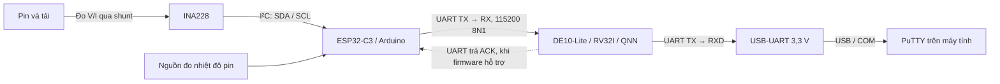

# Kịch bản đi dây và chạy INA228 → ESP32-C3 → DE10-Lite

Cập nhật ngày 06/10/2026. Người dùng chọn Arduino cho ESP32-C3, ESP đọc INA228,
thu mẫu rồi gửi sang DE10-Lite để CPU RV32I và QNN xử lý.

**Hiện đã chạy được demo FPGA: QNN = 12, LED và reset đúng, UART phát `OK`.**
Log phần cứng ngày 05/10/2026 nằm tại
[results.json](../measurements/run_20261005_122529/results.json).
**Firmware nhận mẫu ESP32-C3 chưa được ghép vào project.**
`firmware/main.c` hiện đọc cảm biến bằng I²C của FPGA; ROM baseline đang nạp
là demo CPU/QNN. Nối ESP vào RX rồi nạp lại demo sẽ vẫn chỉ nhận `OK`, chưa
chạy SOC từ số đo ESP. Hướng dẫn này xác định cách đi dây, kiểm tra từng đoạn
và điều kiện để chạy toàn luồng; không coi bước chưa triển khai là đã PASS.

## 1. Sơ đồ sử dụng



USB-Blaster của kit dùng để nạp FPGA. USB-UART dùng để xem UART trên PuTTY.
USB của ESP dùng để nạp Arduino và xem log ESP. Ba đường này có vai trò riêng.

Chuẩn bị DE10-Lite, ESP32-C3, module INA228, USB-UART TTL 3,3 V, cáp USB có
truyền dữ liệu, dây nối, đồng hồ và nguồn/tải phù hợp với pin và shunt thực tế.
Nguồn đo nhiệt độ pin cần có trước khi xác minh SOC đủ bốn đặc trưng.

## 2. Ghi lại cấu hình trước khi đi dây

| Mục | Giá trị cần xác nhận |
|---|---|
| ESP32-C3 | Tên board/revision; sơ đồ chân của đúng board |
| Arduino | File `.ino`, thư viện INA228 và phiên bản đang dùng |
| SDA/SCL ESP | GPIO trong `Wire.begin(SDA, SCL, ...)` của sketch |
| TX/RX sang FPGA | GPIO rảnh được chọn riêng cho `Serial1` |
| INA228 | Tên module, nguồn logic, pull-up và sơ đồ module |
| Địa chỉ I²C | Địa chỉ 7 bit từ strap/scan và xác nhận ID INA228 |
| Shunt | Điện trở, công suất, sai số; có sẵn trên module hay shunt ngoài |
| Calibration | CURRENT_LSB và ADCRANGE thực sự dùng trong Arduino |
| Pin/tải | Điện áp, dòng dự kiến, vị trí lấy VBUS, chiều IN+/IN− |
| Nhiệt độ pin | Cảm biến/nguồn đo, đơn vị và vị trí đo |
| COM | COM của USB-UART FPGA và COM nạp/log ESP |

Chưa có file `.ino` hoặc model board ESP trong workspace. Vì vậy hướng dẫn
không mặc định GPIO SDA/SCL/TX của ESP, địa chỉ INA228 hay giá trị shunt.
Các nhãn `ESP_SDA`, `ESP_SCL`, `ESP_TX`, `ESP_RX` dưới đây là GPIO cần điền từ
sketch/sơ đồ board. Số GPIO ESP không phải số chân theo thứ tự trên header.

## 3. Cấp nguồn và GND

1. Ngắt nguồn trước khi thay dây. Lúc đầu để đường pin/tải chưa kết nối để
   kiểm tra phần logic riêng.
2. Cấp nguồn kit bằng kết nối nguồn USB-Blaster theo board; cấp ESP bằng USB
   của ESP. Cắm USB-UART vào máy tính để cấp nguồn adapter.
3. Nối GND ESP, GND INA228, GND kit và GND USB-UART chung một điểm tham chiếu.
4. Để chân VCC/5V/3V3 của USB-UART không nối vào kit. Không nối chéo hai đường
   3V3/5V của ESP và kit khi cả hai đã có nguồn.
5. INA228 nhận nguồn logic theo module. Với module được nhà sản xuất xác nhận
   dùng nguồn/pull-up 3,3 V, nối nguồn đó từ ESP 3V3; với module có regulator
   hoặc level shifter, làm theo sơ đồ module. Mức SDA/SCL phía ESP phải phù hợp
   với logic 3,3 V.

Chân cấp nguồn `VS/VCC` của INA228 và chân đo điện áp `VBUS` là hai chức năng
riêng. Điện áp pin đo đi vào mạch đo của INA228; không nối pin+ vào chân
UART/GPIO hoặc đường nguồn 3V3 của ESP/FPGA. Đối chiếu
[datasheet TI, mục 5 và 8.2](https://www.ti.com/lit/ds/symlink/ina228.pdf).

Tắt nguồn kit sẽ mất cấu hình SOF nạp qua JTAG; bật lại cần nạp lại SOF.

## 4. INA228 ↔ ESP32-C3: I²C

| Module INA228 | ESP32-C3 | Cách xác định |
|---|---|---|
| SDA | `ESP_SDA` | GPIO khai báo SDA trong sketch |
| SCL | `ESP_SCL` | GPIO khai báo SCL trong sketch |
| GND | GND ESP | Chung GND logic |
| VS/VCC | Nguồn phù hợp module | Xác nhận nguồn và pull-up trước khi cấp |
| A0/A1 hoặc jumper address | Theo module | Giữ strap và ghi địa chỉ thực |
| ALERT | Để không nối nếu sketch không dùng | Không cần cho việc poll mẫu |

Trong cấu trúc này ESP là I²C master của INA228; GPIO I²C pin 1/2 của DE10-Lite
để không nối vào bus INA228. Hướng dẫn ghép hiện tại không dùng hai master trên
cùng bus cảm biến.

Tìm cấu hình này trong sketch, giữ GPIO đã chạy được:

```cpp
// Các biến ESP_SDA / ESP_SCL phải được định nghĩa theo board và dây thực.
Wire.begin(ESP_SDA, ESP_SCL, 100000);
```

Arduino-ESP32 cho phép chỉ định SDA/SCL và tần số bus; mặc định phụ thuộc board.
Bus I²C cần pull-up. Xem
[API I²C của Espressif](https://docs.espressif.com/projects/arduino-esp32/en/latest/api/i2c.html).

## 5. Đường đo pin và shunt

Đây là sơ đồ chức năng đo phía dương; tên cọc trên module phải được đối chiếu
với sơ đồ của module trước khi nối:

```text
PIN + ── nút A ── SHUNT ── nút B ── TẢI +
           │                 │
       sense IN+         sense IN−

PIN − ───────────────────────────── TẢI −
  │
  └── GND đo / GND logic, với hệ đo pin đơn cùng tham chiếu này

VBUS INA228 → nút đo điện áp pin đã xác định từ sơ đồ module
```

Dòng tải chạy qua shunt và cọc/cáp chịu dòng. Hai chân IN+/IN− của IC lấy tín
hiệu áp trên shunt, không phải dây cấp dòng tải. Module có shunt tích hợp phải
được dùng đúng cọc đo theo nhà sản xuất; không suy ra cọc đo chỉ từ tên in trên
ảnh chưa xác nhận. Công suất shunt cần phù hợp `I²R`; calibration phụ thuộc
Rshunt và CURRENT_LSB. Xem
[datasheet INA228, mục 8.1.2 và 8.2](https://www.ti.com/lit/ds/symlink/ina228.pdf).

Với cách sense IN+ ở A và IN− ở B như trên, dòng xả thường cho kết quả INA
dương. Model trong project yêu cầu **dòng dương khi sạc, âm khi xả**. Kiểm tra
dấu bằng một tải đã biết và đổi dấu trong phần chuẩn hóa Arduino nếu cần;
không tự đổi dấu khi chưa xác định hướng sense.

Sau khi kiểm tra logic/I²C, mới nối đường pin/tải theo sơ đồ thực. So sánh
điện áp và dòng từ Arduino với đồng hồ, kiểm tra cả đơn vị và dấu dòng.

## 6. ESP32-C3 → DE10-Lite → USB-UART

### 6.1. Pin vật lý JP1 của DE10-Lite

Pin đã đối chiếu QSF của project và
[manual Terasic, hình 3-18 trang 30](https://eecs.engineering.oregonstate.edu/education/inventory_datasheets/P1533579709.pdf#page=31).
Xác định dấu pin 1 trên PCB; sơ đồ dưới mô tả đánh số theo hình manual, không
giả định hướng trái/phải khi bạn xoay board:

```text
      Cặp chân JP1, từ đầu pin 1
   1  GPIO[0]       GPIO[1]   2   (I²C FPGA, không dùng cho INA qua ESP)
   3  UART_TX       UART_RX   4
   5  ...           ...      6
   7  ...           ...      8
   9  ...           ...     10
  11  5V            GND     12
      ...           ...
  29  3V3           GND     30
```

GPIO[2] tương ứng pin vật lý 3; GPIO[3] tương ứng pin vật lý 4.

### 6.2. Bảng đi dây cuối cùng

| Từ | Tới | Vai trò |
|---|---|---|
| UART `ESP_TX` | JP1 **pin 4**, UART_RX, pad W9 | Mẫu ESP gửi vào FPGA |
| GND ESP | JP1 **pin 12 hoặc 30** | Tham chiếu UART chung |
| JP1 **pin 3**, UART_TX, pad V9 | **RXD USB-UART** | FPGA phát kết quả ra PuTTY |
| GND USB-UART | JP1 **pin 12 hoặc 30** | GND adapter |
| JP1 pin 3 | `ESP_RX`, nếu dùng ACK/kết quả trả về | FPGA trả lời ESP; chỉ nối khi cần |
| **TXD USB-UART** | **Để không nối** trong cấu hình ESP gửi mẫu | FPGA RX đã nhận từ ESP |
| **VCC/5V/3V3 USB-UART** | **Để không nối** | Không cấp nguồn chéo |

Một TX FPGA có thể nối tới RX adapter và RX ESP cùng mức logic khi cần trả
ACK. Không nối TX ESP và TXD adapter cùng vào pin 4: mỗi đường RX chỉ có một
nguồn phát trong cấu hình này. UART dùng TTL 3,3 V, 115200 baud, 8N1, không
đảo tín hiệu, không dùng RTS/CTS.

### 6.3. UART riêng trong Arduino

Dùng UART1 cho dữ liệu FPGA để tách khỏi log/nạp ESP. Đoạn sau là cấu hình để
ghép vào sketch có sẵn, không phải chương trình đọc INA228 hoàn chỉnh:

```cpp
// ESP_RX và ESP_TX là GPIO rảnh đã xác nhận trên board.
// Nếu chưa nối ACK, ESP_RX có thể được cấu hình nhưng để dây RX không nối.
Serial1.begin(115200, SERIAL_8N1, ESP_RX, ESP_TX);
```

Thứ tự đối số là **RX trước, TX sau**. ESP32-C3 có UART1; xem
[API Serial của Espressif](https://docs.espressif.com/projects/arduino-esp32/en/latest/api/serial.html).
Đối chiếu GPIO đang dùng bởi USB, flash, nút boot, LED và ngoại vi trong đúng
board trước khi chọn GPIO. GPIO4/5/6/7 có xuất hiện trên
[DevKitM-1 chính hãng](https://docs.espressif.com/projects/esp-dev-kits/en/latest/esp32c3/esp32-c3-devkitm-1/user_guide.html);
điều này không xác nhận sơ đồ của SuperMini hoặc board khác của bạn.

## 7. Trình tự chạy theo từng đoạn

### Bước A — Kiểm tra FPGA và PuTTY bằng demo đã có

Chỉ cần USB-Blaster, kit và USB-UART; ESP chưa cần phát mẫu.

1. Nối JP1 pin 3 → RXD adapter, pin 12/30 → GND adapter; adapter TXD để không
   nối. Cấp nguồn kit và cắm USB-Blaster.
2. PowerShell từ thư mục project, xác nhận cable/chip:

```powershell
& 'C:\intelFPGA_lite\20.1\quartus\bin64\quartus_pgm.exe' -l
& 'C:\intelFPGA_lite\20.1\quartus\bin64\jtagconfig.exe'
```

Phải nhận đúng cable và chip 10M50. Cable từng thấy là `USB-Blaster [USB-0]`;
chọn theo lần enumerate hiện tại.

3. Nạp đúng SOF demo đã lưu; ví dụ khi cable vẫn là USB-0:

```powershell
& 'C:\intelFPGA_lite\20.1\quartus\bin64\quartus_pgm.exe' `
  -c 'USB-Blaster [USB-0]' -m JTAG `
  -o 'p;measurements/run_20261005_122529/riscv_soc.sof'
```

SHA256 của demo:
`6c9d103d173a53ec0135bedd85e385543094c9ee7234e4837f6b3f996587b934`.
Kết thúc nạp cần có `Configuration succeeded`, không có lỗi.

4. Trong Device Manager → Ports, xác định COM adapter. CH340 từng là COM7;
   COM có thể đổi sau khi cắm lại. COM3 từng là Intel AMT SOL, không dùng cho
   UART kit trong lần đo đã ghi.
5. PuTTY → Connection type **Serial**; Serial line chọn COM adapter; Speed
   **115200**. Connection → Serial: Data bits **8**, Stop bits **1**, Parity
   **None**, Flow control **None**. Open.
6. Nhấn/nhả **KEY[0] sau khi PuTTY đã mở**. Nhận `OK`, không có newline.
   LEDR[2], LEDR[3], LEDR[9] sáng; LEDR[8] tắt. LEDR[9] sáng do EBREAK kết thúc
   demo. Thao tác này khởi động lại FPGA, không reset ESP.

Đây là kết quả đã được xác nhận trên board ngày 05/10/2026. Demo không kiểm tra
đường nhận mẫu từ ESP. PuTTY và chương trình capture không được mở cùng COM
đồng thời. Đóng đúng ứng dụng đang chiếm COM nếu ứng dụng kia không mở được.

### Bước B — Chạy Arduino đọc INA228 riêng

1. Mở sketch `.ino` hiện có trong Arduino IDE. Nếu chưa cài hỗ trợ ESP32,
   dùng URL Boards Manager stable
   `https://espressif.github.io/arduino-esp32/package_esp32_index.json`, cài
   package **esp32 by Espressif Systems**, chọn profile đúng board C3.
   Xem [hướng dẫn Espressif](https://docs.espressif.com/projects/arduino-esp32/en/latest/installing.html).
2. Chọn COM của ESP, phân biệt với COM adapter của FPGA. Nếu board dùng USB
   native hay USB-UART bridge, chọn tùy chọn USB/board theo đúng board; không
   dùng cấu hình của một board C3 khác khi chưa đối chiếu.
3. Xác nhận GPIO SDA/SCL trong sketch khớp dây, thư viện đúng INA228, địa chỉ
   và calibration đúng module. Không mặc định 0x40 hay shunt 10 mΩ từ testbench.
4. Verify → Upload; mở Serial Monitor ở baud mà sketch dùng. Cổng log ESP
   không nhất thiết phải cùng baud với UART1 FPGA; UART1 FPGA là 115200.
5. Kiểm tra nhận đúng INA228, số đo không bị mất calibration, điện áp/dòng
   đúng đơn vị và đúng dấu so với đồng hồ. Ghi thêm nhiệt độ die như thông tin
   chẩn đoán, không coi nó là nhiệt độ pin.

Đạt bước B khi Arduino đọc số đo thật ổn định và đúng cấu hình. Đạt bước này
chưa chứng minh FPGA nhận được mẫu.

### Bước C — Kiểm tra riêng TX ESP trước khi ghép FPGA RX

Có thể thực hiện với chính adapter USB-UART đã dùng:

1. Đổi dây RXD adapter từ JP1 pin 3 sang `ESP_TX`; GND adapter nối GND ESP.
   Chỉ đổi dây khi các thiết bị đã ngắt nguồn; sau khi bật kit cần nạp lại SOF.
   Không nối đồng thời TX ESP và TX FPGA cùng vào RXD adapter.
2. Mở PuTTY trên COM adapter, 115200 8N1, Flow control None.
3. Cho sketch gửi một bản ghi thử qua **Serial1**, kiểm tra đúng byte/dòng trên
   PuTTY. Dòng thử chỉ dùng để kiểm tra đường phát, không phải số đo pin thật.
4. Kiểm tra số đo cũng được gửi qua UART1, không chỉ xuất qua USB Serial Monitor.
5. Đổi lại RXD adapter → JP1 pin 3, nối `ESP_TX` → JP1 pin 4 và GND chung để
   chuẩn bị chạy toàn luồng.

Baseline FPGA không echo UART RX; gửi mẫu vào pin 4 với demo đang chạy không
tạo kết quả SOC hoặc dòng phản hồi. Đường ESP → FPGA chỉ được đánh dấu PASS
sau khi chạy receiver firmware và đối chiếu nội dung mẫu.

### Bước D — Ghép firmware nhận UART và tạo SOF riêng

**Bước này còn phải triển khai sau khi có sketch và định dạng gửi thực tế.**

Phần cần ghép: Arduino gửi mẫu; firmware RV32I đọc `UART_STATUS`/`UART_RX_DATA`,
giải mã frame và lỗi RX, giữ đúng thứ tự/thời điểm mẫu, tạo 80 feature rồi gọi
QNN. UART RX phần RTL đã tồn tại; chưa có receiver trong `firmware/main.c`.

Đơn vị dữ liệu theo model hiện tại:

| Trường | Đơn vị / ý nghĩa |
|---|---|
| sequence / thứ tự | Phát hiện thiếu/lặp/đảo mẫu và reset ESP |
| timestamp hoặc delta_ms | Thời điểm lấy mẫu tại ESP, không phải lúc nhận UART |
| voltage_mv | Điện áp pin theo mV |
| current_ma | Dòng mA có dấu, dương khi sạc |
| cell_temperature_deci_c | Nhiệt độ pin thật, đơn vị 0,1°C |
| validity | Nêu rõ số đo hợp lệ; nhiệt độ pin có/không có |

Ví dụ dữ liệu đã chuẩn hóa: 3,402 V → 3402 mV; −1 A → −1000 mA;
22,5°C → 225; khoảng lấy mẫu 10 s → 10000 ms. Đây chỉ là ví dụ đơn vị.
CSV hay binary phải được hai bên thống nhất; chưa có định dạng wire đã được
triển khai, vì vậy không coi một dòng CSV tự chọn là FPGA đã hiểu được.

ESP có thể thu đủ 20 mẫu rồi gửi oldest-first. Khi gửi một batch, giữ nguyên
timestamp/khoảng lấy mẫu gốc; không lấy khoảng cách giữa các byte/frame UART
làm `delta_ms`. FIFO RX RTL hiện là 16 byte, không đủ giữ cả batch trong lúc
CPU chưa đọc. Cần firmware đọc liên tục và cơ chế pacing/ACK hoặc giao thức
batch đã được kiểm thử; `Serial1.flush()` chỉ đợi phát hết, không chứng minh
FPGA đã giải mã/nhận đủ.

Model có chu kỳ mẫu danh định 10 s. Từ mẫu thứ nhất đến mẫu thứ 20 là 190 s
nếu lấy đều 10 s, chưa tính khởi động và lịch lấy mẫu ban đầu. Pipeline hiện
xóa cửa sổ khi mẫu V/I lỗi hoặc khoảng mẫu không hợp lệ / vượt 15 s. Nếu thiếu
nhiệt độ pin, chưa được tính SOC đủ đầu vào. Đoạn firmware hiện tại cho đường
I²C board có thể báo `CELL_TEMP_REQUIRED`; đó không phải log sẵn có của một
receiver ESP.

Khi receiver đã được ghép và kiểm thử, build vào thư mục riêng. Lệnh sau hiện
chỉ build `main.c` đang có, không tự tạo chế độ nhận ESP:

```bash
python3 scripts/build_firmware.py \
  --prefix riscv64-unknown-elf- \
  --output-dir firmware/build/esp_uart_review
```

Tạo project/top hoặc revision đo riêng để chọn ROM mới; ảnh phải được trỏ từ
parameter `ROM_INIT_FILE` của top thực sự compile. Giữ nguyên core frozen và
`firmware/build/boot.*`. Full compile, xác nhận INIT_FILE và timing
setup/hold/recovery/removal ở các corner trước khi nạp SOF mới. Nạp lại SOF
demo cũ sẽ vẫn chạy demo cũ, dù đã build một firmware C mới ở thư mục khác.

### Bước E — Chạy batch 20 mẫu trên toàn hệ

Sau khi bước D hoàn tất:

1. Đấu toàn bộ bảng 6.2, nạp firmware ESP và SOF receiver tương ứng.
2. Mở PuTTY trên COM USB-UART FPGA trước khi ESP bắt đầu gửi.
3. Khởi động receiver FPGA; chỉ cho ESP gửi khi receiver đã sẵn sàng theo
   giao thức đã triển khai. Nếu reset KEY giữa batch, bắt đầu lại cửa sổ đủ
   20 mẫu; không ghép các phần trước/sau reset thành một cửa sổ.
4. ESP thu 20 mẫu V/I/nhiệt độ pin với thời điểm gốc, rồi truyền theo thứ tự.
5. Đối chiếu số mẫu, đơn vị, dấu dòng, feature và kết quả QNN với reference
   dùng cùng model. Kết quả `SOC=...%` là tiêu chí sau khi receiver có chức
   năng xuất kết quả, không phải chuỗi mà demo `OK` sẽ tự chuyển thành.
6. Lưu dữ liệu mẫu ESP, UART raw/log, cấu hình shunt/calibration, firmware/SOF
   hash và model ID cùng một lần đo. Giá trị 12 của demo không phải SOC từ pin
   thật; LED số hiển thị của firmware thực phải đối chiếu cách firmware mã hóa.

## 8. Kiểm thử trên máy trước khi nạp firmware ghép

Từ thư mục project trong WSL; Python/Icarus/compiler trên máy đã từng dùng để
chạy thành công:

```bash
python3 scripts/check_core_freeze.py
python3 scripts/run_firmware_tests.py
python3 scripts/run_tests.py --scope all
```

ModelSim từ PowerShell:

```powershell
.\scripts\run_tests.ps1 -Scope All -Stress
```

Các suite hiện tại kiểm tra UART RX và firmware fake/direct-I²C INA228.
Cần thêm test firmware UART mẫu ESP trước khi tuyên bố đường mới PASS.
Không cần sửa core để tạo đường ứng dụng này.

## 9. Khi không thấy dữ liệu

| Hiện tượng | Kiểm tra tiếp |
|---|---|
| Không có USB-Blaster | Nguồn kit, cáp data, Device Manager/driver, jtagconfig |
| PuTTY không mở COM | Chọn COM adapter thực; đóng chương trình đang giữ COM |
| Demo không hiện `OK` | Đúng SOF, JP1 pin 3 → RXD, GND, baud; reset sau Open |
| Nhận ký tự sai | Baud 115200, 8N1, mức 3,3 V, GND và đường TX đang nghe |
| ESP thấy INA nhưng dòng bằng 0/sai | Shunt, calibration, CURRENT_LSB, dải ADC và đường dòng |
| Serial Monitor ESP có dữ liệu, PuTTY không có | Có gửi qua UART1 chưa; GPIO TX đúng chưa |
| Gửi ESP mà FPGA chỉ có `OK` | Đang dùng SOF demo; chưa có receiver firmware |
| Thiếu mẫu khi gửi batch | Receiver/pacing/ACK, RX overrun và sequence; reset cửa sổ lỗi |
| V/I đúng nhưng chưa có SOC | Nhiệt độ pin, 20 mẫu hợp lệ, timestamp và model |

## 10. Phiếu ghi một lần chạy

```text
Ngày/giờ:
Board ESP32-C3 / revision:
Sketch / thư viện / phiên bản:
SDA GPIO:          SCL GPIO:
UART1 TX GPIO:    UART1 RX GPIO (nếu dùng):
Module INA228:
I²C address 7 bit:
Rshunt µΩ / công suất / sai số:
CURRENT_LSB / ADCRANGE / calibration:
Điểm VBUS / chiều IN+ IN− / quy ước dòng:
Nguồn nhiệt độ pin / calibration:
COM ESP:          COM USB-UART FPGA:
SOF / SHA256:     Firmware / model ID:
Số mẫu / thời điểm gốc / số frame nhận:
UART log/raw:
Kết quả mong đợi / quan sát / sai lệch:
PASS hoặc bước còn thiếu:
```

Các bước có thể tự chạy ngay: A với demo đã lưu; B với sketch INA228 của bạn;
C sau khi UART1 được thêm vào sketch. D/E cần sketch, cấu hình board và
receiver firmware trước khi thực hiện trọn vẹn. File `.ino` có sẵn của bạn là
đầu vào còn thiếu để ghép phần mềm cho đúng board và dữ liệu đang sử dụng.
