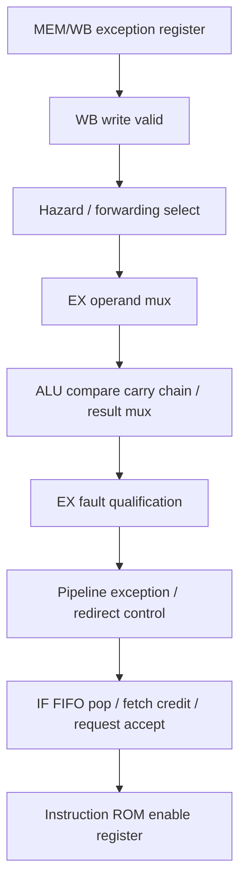

# Timing review trước khi chốt core

Ngày: 2026-09-27. Baseline P0/P1; không thay RTL hay SDC trong phase này.

## Đường critical thực tế

Nguồn: `tmp/p0p1_timing/setup_paths.rpt`, path #1, slow 1200 mV 85°C.
Thanh ghi nguồn `u_soc|u_core|memwb_exc_valid_q`; thanh ghi đích
`u_soc|u_rom|u_storage|u_altsyncram|auto_generated|ram_block1a6~porta_re_reg`.
Đây là enable của cổng instruction ROM M9K.

Đồ thị diễn tả dependency tổ hợp, không có nghĩa exception thật phải thực thi
phép so sánh. Quartus xét đường truyền điện qua logic chia sẻ, kể cả mux select.
Không được biến đường này thành false path nếu chưa chứng minh điều kiện loại trừ.

| Mốc netlist | Fanout | Thời gian tích lũy từ launch clock (ns) |
|---|---:|---:|
| `memwb_exc_valid_q` Q | 3 | 3.937 |
| `u_regfile\|write_valid~1` | 4 | 5.191 |
| `u_hazard_unit\|always0~1` | 1 | 6.398 |
| `u_ex_stage\|WideNor1~0` | 32 | 6.936 |
| `Selector61~4` | 3 | 7.800 |
| `ex_operand_b[2]~2` | 78 | 8.644 |
| ALU `LessThan0~5` → `LessThan0~62` | 1 mỗi đoạn | 11.536 → 13.825 |
| ALU `Mux31~5` | 5 | 15.056 |
| `fault_raw_o~7` | 11 | 15.888 |
| `ex_fault_event_o~2` | 1 | 16.769 |
| IF `fifo_pop` | 7 | 17.531 |
| IF `request_accept~0` | 13 | 18.174 |
| ROM `comb~4` | 32 | 19.318 |
| ROM enable register | 1 | 21.694 |

TimeQuest báo **12 logic levels**; chuỗi carry có nhiều cell vật lý hơn số level
logic được báo. Data delay 17.964 ns gồm routing 11.430 ns, cell 6.327 ns,
clock-to-Q 0.207 ns. Clock skew +0.193 ns; required time 23.466 ns;
arrival time 21.694 ns; setup slack +1.772 ns tại period 20 ns.

## So sánh lựa chọn trước khi implement

| Lựa chọn | Độ phức tạp / latency | Rủi ro / tài nguyên | Verification | Fmax dự kiến |
|---|---|---|---|---|
| A — giữ nguyên RTL, chốt baseline 50 MHz | Không thêm logic/cycle | Thấp nhất; tài nguyên giữ nguyên | Regression + ISA + compile/STA lại | Khoảng 54.86 MHz; không hứa cải thiện |
| B — tách phép tính địa chỉ/alignment khỏi ALU dùng chung | Vừa; mục tiêu không thêm cycle | Có thể thêm adder/LUT, đổi cone EX fault | Cần test trước cho JALR/LSU/alignment, exception ordering và toàn bộ regression | Có thể rút đường compare → fault; chưa có số MHz nếu chưa place-and-route |
| C — thêm thanh ghi ở đường fetch/ROM enable | Cao; ít nhất một cycle ở giao tiếp bị ảnh hưởng | Đụng credit/outstanding/wrong-path, thêm FF | Phải chứng minh lại protocol fetch và redirect | Không định lượng khi chưa implement |

**Chọn A.** Không có bug ISA tái hiện, mục tiêu bắt buộc 50 MHz đã đạt và yêu cầu
phase B ưu tiên review, không redesign core. B/C là phương án nghiên cứu, chưa
implement; không có thay đổi timing để rollback. Nếu thử về sau, phải có test trước,
full regression PASS, hold/recovery/removal PASS và tăng ít nhất 2 MHz mới xét giữ.

## Baseline ba corner

| Corner | Setup | Hold | Recovery | Removal |
|---|---:|---:|---:|---:|
| Slow 85°C | +1.772 | +0.245 | +17.049 | +2.394 |
| Slow 0°C | +3.173 | +0.247 | +17.275 | +2.177 |
| Fast 0°C | +12.095 | +0.097 | +18.665 | +1.069 |

Đơn vị ns. Fmax slow 85°C: 54.86 MHz. Tài nguyên 6,353 LE, 3,184 register,
338,944 memory bits, 3 DSP 9-bit. 60 MHz+ chưa đạt; không coi mục tiêu này là
điều kiện bắt buộc để freeze. Kết quả compile lại và so sánh cuối phase nằm trong
`bao_cao_freeze_isa_soc_vi.md`.
